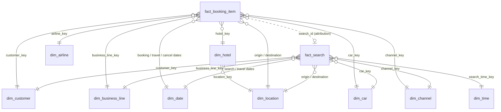

# Travel Booking Warehouse

[](https://github.com/hunterhope123/travel-booking-warehouse/actions/workflows/tests.yml)

A dimensional data warehouse for an online travel agency where users search for and book flights, hotels and rental cars, with or without an account. The goal is customer intelligence: conversion funnels, unmet demand, and growth by business line.

**Stack:** SQL and Python. Databricks (Delta Lake, Unity Catalog) is the target platform and my main stack. Everything here runs and is tested locally in DuckDB on dummy data, so anyone can run it on a laptop without a cloud workspace; the SQL patterns (star schema, CTEs, window functions, `QUALIFY`) carry over to Databricks SQL. The DDL notes what changes on Delta.

## Run it

```bash
python -m venv .venv && source .venv/bin/activate
pip install -r requirements.txt
python test_warehouse.py      # builds the schema, loads synthetic data, runs every query and prints results
pytest -q                     # same checks as assertions
```

## Repo layout

| File | What |
|---|---|
| `sql/01_ddl.sql` | Star schema DDL: 2 facts, 9 dimensions |
| `sql/02_analytics_queries.sql` | Conversion funnel and unmet-demand queries |
| `sql/03_booking_growth_yoy.sql` | YoY booking growth by year and business line |
| `test_warehouse.py` | Builds everything in DuckDB on synthetic data and validates the results |
| `.github/workflows/tests.yml` | Runs the tests on every push (GitHub Actions) |

## Data model and key design decisions

A Kimball star schema with **two fact tables** at clearly different grains and a shared set of conformed dimensions. Full DDL: [`sql/01_ddl.sql`](sql/01_ddl.sql).



| Table | Grain |
|---|---|
| `fact_search` | One row per search, any business line |
| `fact_booking_item` | One row per booked item (a flight, a hotel stay, a car rental); `booking_id` groups items bought together |
| `dim_customer` | One row per customer version (SCD Type 2): registered, guest, and an "Anonymous" member |
| `dim_location` | Airports and cities, used in two roles (origin and destination) |
| `dim_date`, `dim_time`, `dim_business_line`, `dim_airline`, `dim_hotel`, `dim_car`, `dim_channel` | Conformed lookups |

**Key decisions**

1. **Searches and bookings are separate facts.** They happen at different grains and volumes (searches outnumber bookings 10-20x). Keeping them apart keeps each fact clean, and `search_id` on the booking links them for funnel analysis.
2. **One search fact for all three lines, not three.** Flights, hotels and cars share most attributes: who, when, where, how many people. Line-specific fields are nullable, or point at a `-1` "Not applicable" dimension member, so fact keys are never NULL. Conversion and funnel questions across lines then become one query instead of a three-way UNION.
3. **Guests are first-class customers.** Booking doesn't require registration, so `dim_customer` holds guests keyed on a token of their email: a keyed HMAC (secret held outside the warehouse) or a tokenization service. A plain hash is not enough, because emails are guessable. This keeps raw PII out of the warehouse; matching only works when an email or other reliable identifier was captured. A guest who books twice is still one customer, and SCD2 keeps history when that guest later registers. Searches with no identity map to the `-1` Anonymous member.
4. **Booking-item grain with `booking_id` as a degenerate dimension.** A trip with a flight and a hotel is two rows. That gives correct per-line counts and revenue (what the growth query needs) without double counting the cart.
5. **Role-playing dimensions.** `dim_date` serves as booking, travel start/end and cancellation date. `dim_location` serves as origin and destination. Lead time (search date to travel date) is stored on the fact because it's a key behavioural measure.
6. **"Previous five searches" and "past reservations" are app features, not warehouse features.** They're served from the operational database or a cache. The warehouse keeps the full history for analytics. In the lakehouse, raw click events land in bronze, are cleaned and sessionised in silver, and this star is the gold layer.

## Analytics queries

Both are in [`sql/02_analytics_queries.sql`](sql/02_analytics_queries.sql) and were tested against synthetic data.

- **A. Search-to-booking conversion by business line and month, registered vs. guest.** Conversion is the core health metric for a travel site. Each booking is credited to the search that produced it (`search_id`), and both are grouped by the search date, so a September search that books in October is a September conversion. A search counts as converted once, however many items it led to. The query shows which line loses the most demand, and whether registered users convert better than guests.
- **B. Unmet demand by destination.** This finds destinations with many searches but low conversion. Unconverted searches are an estimate of unmet demand, not proof of missing supply: price, sold-out dates, abandoned sessions and bookings made elsewhere all lower conversion. It shows where to look first for inventory, partner or pricing gaps.

## Year-over-year booking growth by business line

[`sql/03_booking_growth_yoy.sql`](sql/03_booking_growth_yoy.sql). The core of it:

```sql
SELECT year, business_line, bookings,
       LAG(bookings) OVER w AS prior_year_bookings,
       ROUND(100.0 * (bookings - LAG(bookings) OVER w) / NULLIF(LAG(bookings) OVER w, 0), 2) AS booking_growth_pct
FROM filled            -- yearly net bookings per line, zero-filled on a year x line spine
WINDOW w AS (PARTITION BY business_line ORDER BY year)
```

Definition choices, each documented in the file:
- A booking is a booked item, so a flight + hotel trip counts once per line.
- Year means the booking year, not the travel year.
- Cancellations are excluded (net bookings).
- `NULLIF` avoids divide-by-zero.
- A year x line spine means a year with zero bookings doesn't make `LAG` compare against the wrong year.

Booking volume growth is the answer to the question; the query also returns value (USD) growth as a secondary measure.

### Sample output (synthetic data)

`python test_warehouse.py` loads 4 years of synthetic data (about 3,800 booked items and 40,000 searches). The data was generated with fixed growth rates, so the query can be checked against a known answer:

| Business line | 2024 | 2025 | 2026 | Rate built into the data |
|---|---|---|---|---|
| Hotel | +31.6% | +38.0% | +32.9% | +35%/yr |
| Flight | +15.9% | +24.3% | +19.8% | +20%/yr |
| Car | -8.7% | -13.5% | -7.3% | -10%/yr |

The test asserts this ordering (Hotel > Flight > 0 > Car) and that each line's first year has no growth value. Net bookings are lower than gross because about 8% of items are cancelled.

## Scaling: what breaks first if bookings spike overnight?

**First, check whether the spike is real.** A sudden overnight jump is more often a bug than a business event: duplicate events from an app release, a retry storm, or bot traffic. A volume check (today vs. trailing median, by line) should hold gold back from publishing until someone confirms. Deduplicating on the natural key (`booking_item_id`) makes reloads safe.

**If it's real, the pressure shows up in this order:**

1. **Ingestion throughput.** The nightly batch has more to read and land than its window allows, and a backlog builds. Everything downstream is late.
2. **Incremental fact loading.** A MERGE into an unpartitioned `fact_booking_item` scans or rewrites far more than the new day's rows, and concurrent writers to the same table contend.
3. **Dimension lookups and SCD Type 2.** Every guest booking can add a `dim_customer` row, so the dimension grows as fast as the fact. The surrogate-key lookup and SCD2 change detection slow down, and late-arriving customers or hotels land as unknowns more often.
4. **Downstream reporting.** Dashboards querying the raw fact slow down as it grows.

**Fixes, matched to each:**

1. Move from a nightly batch to micro-batch or streaming ingestion (Event Hubs/Kafka → Auto Loader / Structured Streaming) so each run handles a small increment, and autoscale compute.
2. Cluster `fact_booking_item` by `booking_date` (Delta liquid clustering) and MERGE only the affected dates, using a watermark on `_loaded_at`. Use one writer per table per run.
3. Use deterministic hash keys (e.g. `sha2(customer_nk)`) so facts don't wait on a lookup, and insert inferred members for late arrivals. Hash keys do not remove SCD2: the dimension still needs effective dates to tell customer versions apart, so the fact join uses the key plus the booking time (or a version key resolved in a separate step).
4. Pre-aggregate daily summary tables for dashboards so BI load doesn't grow with the raw fact.
