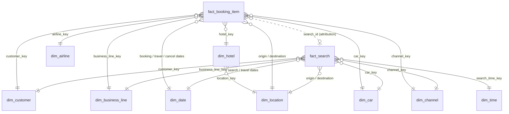

# Travel Booking Warehouse

[](https://github.com/hunterhope123/travel-booking-warehouse/actions/workflows/tests.yml)

A dimensional data warehouse for an online travel agency where users search for and book flights, hotels and rental cars, with or without an account. The goal is customer intelligence: conversion funnels, unmet demand, and growth by business line.

**Stack:** SQL (ANSI-style, tested on DuckDB; ports to Snowflake or Databricks), Python test harness.

## Run it

```bash
python -m venv .venv && source .venv/bin/activate
pip install -r requirements.txt
python test_warehouse.py      # builds the schema, loads synthetic data, runs every query and prints results
pytest -q                     # same checks as assertions
```

## Repo layout

| File | What |
|---|---|
| `sql/01_ddl.sql` | Star schema DDL: 2 facts, 9 dimensions |
| `sql/02_analytics_queries.sql` | Conversion funnel and unmet-demand queries |
| `sql/03_booking_growth_yoy.sql` | YoY booking growth by year and business line |
| `test_warehouse.py` | Builds everything in DuckDB on synthetic data and validates the results |
| `.github/workflows/tests.yml` | Runs the tests on every push (GitHub Actions) |

## Data model and key design decisions

A Kimball star schema with **two fact tables** at clearly different grains and a shared set of conformed dimensions. Full DDL: [`sql/01_ddl.sql`](sql/01_ddl.sql).



| Table | Grain |
|---|---|
| `fact_search` | One row per search, any business line |
| `fact_booking_item` | One row per booked item (a flight, a hotel stay, a car rental); `booking_id` groups items bought together |
| `dim_customer` | One row per customer version (SCD Type 2): registered, guest, and an "Anonymous" member |
| `dim_location` | Airports and cities, used in two roles (origin and destination) |
| `dim_date`, `dim_time`, `dim_business_line`, `dim_airline`, `dim_hotel`, `dim_car`, `dim_channel` | Conformed lookups |

**Key decisions**

1. **Searches and bookings are separate facts.** They happen at different grains and volumes (searches outnumber bookings 10-20x). Keeping them apart keeps each fact clean, and `search_id` on the booking links them for funnel analysis.
2. **One search fact for all three lines, not three.** Flights, hotels and cars share most attributes: who, when, where, how many people. Line-specific fields are nullable, or point at a `-1` "Not applicable" dimension member, so fact keys are never NULL. Conversion and funnel questions across lines then become one query instead of a three-way UNION.
3. **Guests are first-class customers.** Booking doesn't require registration, so `dim_customer` holds guests keyed on a hashed email, which keeps raw PII out of the warehouse. A guest who books twice is still one customer, and SCD2 keeps history when that guest later registers. Searches with no identity map to the `-1` Anonymous member.
4. **Booking-item grain with `booking_id` as a degenerate dimension.** A trip with a flight and a hotel is two rows. That gives correct per-line counts and revenue (what the growth query needs) without double counting the cart.
5. **Role-playing dimensions.** `dim_date` serves as booking, travel start/end and cancellation date. `dim_location` serves as origin and destination. Lead time (search date to travel date) is stored on the fact because it's a key behavioural measure.
6. **"Previous five searches" and "past reservations" are app features, not warehouse features.** They're served from the operational database or a cache. The warehouse keeps the full history for analytics. In the lakehouse, raw click events land in bronze, are cleaned and sessionised in silver, and this star is the gold layer.

## Analytics queries

Both are in [`sql/02_analytics_queries.sql`](sql/02_analytics_queries.sql) and were tested against synthetic data.

- **A. Search-to-booking conversion by business line and month, registered vs. guest.** Conversion is the core health metric for a travel site. This query shows which line loses the most demand, and whether registered users convert better than guests. That second point puts a number on the value of pushing registration.
- **B. Unmet demand by destination.** This finds destinations with many searches but low conversion. Those are supply or pricing gaps, where adding hotel inventory, airline partners or better prices pays off fastest.

## Year-over-year booking growth by business line

[`sql/03_booking_growth_yoy.sql`](sql/03_booking_growth_yoy.sql). The core of it:

```sql
SELECT year, business_line, bookings,
       LAG(bookings) OVER w AS prior_year_bookings,
       ROUND(100.0 * (bookings - LAG(bookings) OVER w) / NULLIF(LAG(bookings) OVER w, 0), 2) AS booking_growth_pct
FROM filled            -- yearly net bookings per line, zero-filled on a year x line spine
WINDOW w AS (PARTITION BY business_line ORDER BY year)
```

Definition choices, each documented in the file:
- A booking is a booked item, so a flight + hotel trip counts once per line.
- Year means the booking year, not the travel year.
- Cancellations are excluded (net bookings).
- `NULLIF` avoids divide-by-zero.
- A year x line spine means a year with zero bookings doesn't make `LAG` compare against the wrong year.

The query also returns value (USD) growth.

### Sample output (synthetic data)

`python test_warehouse.py` loads 4 years of synthetic data (about 3,800 booked items and 40,000 searches). The data was generated with fixed growth rates, so the query can be checked against a known answer:

| Business line | 2024 | 2025 | 2026 | Rate built into the data |
|---|---|---|---|---|
| Hotel | +31.6% | +38.0% | +32.9% | +35%/yr |
| Flight | +15.9% | +24.3% | +19.8% | +20%/yr |
| Car | -8.7% | -13.5% | -7.3% | -10%/yr |

The test asserts this ordering (Hotel > Flight > 0 > Car) and that each line's first year has no growth value. Net bookings are lower than gross because about 8% of items are cancelled.

## Scaling: what breaks first if bookings spike overnight?

**First, check whether the spike is real.** A sudden overnight jump is more often a bug than a business event: duplicate events from an app release, a retry storm, or bot traffic. Volume anomaly checks (today vs. trailing median, by line) should stop gold from publishing until someone confirms. Deduping on the natural key (`booking_item_id`) makes reloads safe.

**If it's real, the first thing to break is the incremental load into `fact_booking_item`, specifically the dimension key lookups and the MERGE:**

- Every guest booking can create a new `dim_customer` row, so the customer dimension grows as fast as the fact. The surrogate-key lookup join (and SCD2 change detection) against an ever-larger dimension becomes the slowest step, and the nightly batch misses its window.
- A MERGE into an unpartitioned fact rewrites or scans far more data than the new day's rows.
- Late-arriving dimension rows (a booking before its customer or hotel record arrives) fail lookups or land as unknowns more often.

**Fixes, in order:**

1. Partition or cluster `fact_booking_item` by `booking_date` (Delta liquid clustering or Snowflake clustering keys), and MERGE only the affected partitions using a watermark on `_loaded_at`.
2. Use deterministic hash keys (e.g. `sha2(customer_nk)`) instead of sequence surrogates, so facts no longer wait on dimension lookups. Insert "inferred" dimension members for late arrivals and fill them in later.
3. Move from a nightly batch to micro-batch or streaming ingestion (Event Hubs/Kafka → Auto Loader / Structured Streaming) so each run handles small increments. Autoscale the cluster.
4. Pre-aggregate daily summary tables for dashboards so BI load doesn't grow with the raw fact.
